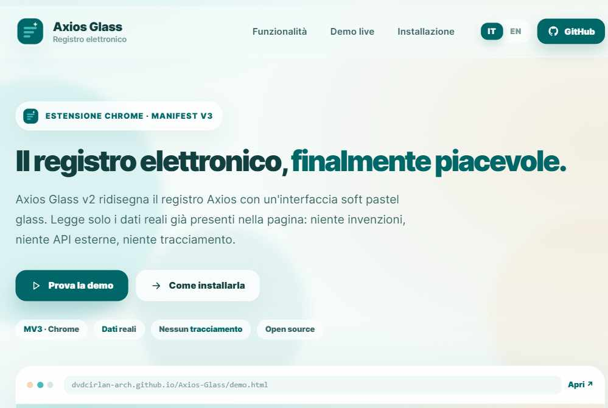

# Axios Glass

[](https://dvdcirlan-arch.github.io/Axios-Glass/)
[](https://github.com/dvdcirlan-arch/Axios-Glass)
[](https://github.com/dvdcirlan-arch/Axios-Glass)

**Nuova interfaccia per il registro elettronico Axios — pastel glass, dati reali, zero tracciamento.**

👉 **Prova la demo live: https://dvdcirlan-arch.github.io/Axios-Glass/**



La pagina è bilingue: usa l'interruttore **IT / EN** in alto a destra. La demo incorporata
è [proprio l'estensione](https://dvdcirlan-arch.github.io/Axios-Glass/demo.html) con dati di esempio:
non serve login, non serve installare nulla.

---

## Perché

Il registro di Axios funziona, ma la sua interfaccia no. Axios Glass la ridisegna da zero
mantenendo intatto il markup ASP.NET originale: `__VIEWSTATE`, form e postback continuano a
funzionare, il contenuto originale viene solo nascosto con CSS.

- **Legge solo dati reali** dal DOM già presente nella pagina: nessun valore inventato, nessuna API esterna.
- **Non distruttiva**: nessun elemento del registro viene cancellato.
- **Palette teal e aqua**: `#006667` + `#48BCBD`, senza marchi o colori di una scuola specifica.
- **Nessun server, nessun analytics**: preferenze e simulazioni restano nel browser.

## Cosa vedi

Dashboard, Voti, Registro di classe, Presenze, Comunicazioni, Orario, Pagella, Impostazioni.

- Media generale, trend, distribuzione dei voti e sparkline SVG, senza librerie esterne.
- Voti: ricerca, filtri (*tutti / ≥6 / <6 / simulati*), ordinamento e dettaglio per materia.
- Registro: filtri per verifiche, compiti e argomenti; navigazione settimana; attività completate salvate.
- Comunicazioni: clicchi un messaggio e leggi testo completo, mittente e data; **Precedente / Successiva**
  navigano tutta la posta, `Esc` o il backdrop chiudono.
- Pagella: solo le righe realmente lette dal documento; se non è pubblicata resta vuota e **non**
  presta le medie della sezione Voti.
- Simulatore *what-if* e calcolatore del voto necessario per raggiungere un obiettivo.

Scorciatoia: `Ctrl / Cmd + K` porta il focus nella ricerca.

---

## Installazione

1. Clona il repository oppure scarica lo ZIP e scompattalo:

   ```powershell
   git clone https://github.com/dvdcirlan-arch/Axios-Glass.git
   cd Axios-Glass
   ```

2. Apri `chrome://extensions/`, attiva **Modalità sviluppatore** e scegli
   **Carica estensione non pacchettizzata**.
3. Seleziona la cartella appena clonata — è già la radice dell'estensione
   (contiene `manifest.json`).
4. **Disabilita la vecchia estensione** `axios-redesign`: due content script iniettino due UI diverse.
5. Fai login su `https://registrofamiglie.axioscloud.it/`: Axios Glass si attiva da solo.
   In alto a destra **Modalità classica** torna all'HTML originale; da lì il pulsante flottante
   **Mostra Axios Glass** ripristina la nuova UI.

### Solo la demo, senza estensione

Apri https://dvdcirlan-arch.github.io/Axios-Glass/demo.html, oppure il file `demo.html`
locale. Se preferisci servirlo in locale:

```powershell
python -m http.server 8766
```

poi visita `http://127.0.0.2:8766/demo.html`.

---

## Dettagli tecnici

Il repository contiene l'estensione nella radice e la landing page in `docs/`.

| File | Ruolo |
|---|---|
| `manifest.json` | Manifest V3, content script solo sui domini Axios |
| `content.js` | Boot, mount non distruttivo, navigazione, MutationObserver, modalità classica |
| `scraper.js` | Lettura del DOM Axios (voti, registro, timeline, sezioni generiche) |
| `core.js` | Normalizzazione dati, statistiche, storage, simulazioni |
| `ui.js` | Rendering di tutte le viste + eventi delegati |
| `styles.css` | Design system pastel glass: token, shell, card, grafici, responsive |
| `demo.html` / `demo.js` | Dati di esempio e controller standalone |
| `docs/` | Landing page GitHub Pages + copia della demo per l'iframe |
| `test-fixture.html`, `test-dashboard.html` | DOM Axios minimale e sanificato per i test |

> `docs/demo.html`, `docs/core.js`, `docs/ui.js`, `docs/demo.js`, `docs/styles.css` e `docs/assets/`
> sono copie usate dalla demo live. Se modifichi la demo, aggiorna anche queste copie.

### Dati e selettori

| Dato | Sorgente |
|---|---|
| Nome studente | `.username` |
| Istituto | `.desc-as-header .pull-left` |
| Anno | `.anno-footer` |
| Avatar | `#imgAvatarHeader` |
| Voti tabella | `#table-voti`, `.table-voti`, `#content-alunno table`, `#page-content table` |
| Voti griglia | `.rdoc_full_valutazioni .voto`, `.table .voto` + tooltip `data-original-title` |
| Registro | `#table-rcla`, settimana da `#fdData` |
| Timeline | `.mt-actions .mt-action`, `.mt-action-author`, `.mt-action-desc` |
| Comunicazioni | righe di tabella; il link cliccabile viene memorizzato per "Apri nel registro" |

Il parser gestisce virgole decimali, suffissi `+ ++ - --`, frazioni `½` e `7/8` e giudizi
(da *insufficiente* a *eccellente*). I voti con *non fa media* restano visibili ma non
entrano nelle medie. Tutte le chiavi `localStorage` usano il prefisso `axiosglass:`.

---

## Privacy

Nessun dato lascia il browser. I file `homepage.html`, `preview.html` e `Login.html`
nella cartella padre (non inclusi in questo repository) sono salvataggi di pagine reali con
token di sessione e dati personali: **non distribuirli**.
